<div align="center">

# 숨길 · Soomgil

### 스와이프로 취향을 모으고, 지도 위에서 함께 만드는 그룹 여행

**개발 인원** 3명<br />
**플랫폼** Web<br />
**공모전** 2026 관광데이터 활용 공모전 웹앱 개발 부문<br />


</div>

---

## 📑 목차

- [📌 서비스 소개](#service-introduction)
- [👥 팀원 소개](#team)
- [✨ 주요 기능](#features)
- [🛠️ 기술 스택](#technology-stack)
- [🏗️ 시스템 아키텍처](#system-architecture)
- [🗄️ ERD](#erd)
- [📋 API 명세](#api-specification)
- [🔬 핵심 기술 상세](#technology-details)
- [🗺️ 활용 관광데이터 및 외부 API](#tourism-data)
- [🌱 발전 계획](#roadmap)
- [🚀 개발자 가이드](#developer-guide)

---

<a id="service-introduction"></a>

## 📌 숨길 서비스 소개

**숨길은 스와이프로 여행 멤버의 취향을 수집하고, 모두가 좋아할 관광지를 추천해 지도 위에서 일정을 함께 만드는 그룹 여행 계획 서비스입니다.**

단체 여행을 준비할 때는 구성원마다 취향이 달라 방문지를 정하기 어렵고, 장소 정보와 일정이 여러 앱과 메신저에 흩어져 관리가 번거롭습니다. 국내에는 매력적인 관광지가 많지만 여행 정보는 일부 유명 지역과 장소에 집중되어 있습니다.

숨길은 **한국관광공사 관광데이터와 관광사진 공모전 수상작**을 활용해 새로운 국내 여행지를 소개합니다. 사용자는 관광지를 평가하며 취향을 남기고, 여행방에서는 **멤버 전체의 취향을 반영한 추천과 스티커 투표**로 함께 갈 장소를 정합니다.

선정한 장소는 지도 위 일정에 바로 추가할 수 있습니다. 멤버들은 **일정과 경로를 공동 편집**하고, AI 여행 가이드와 공동 메모·체크리스트·채팅으로 여행을 준비합니다. 여행 후에는 경험을 여행기로 공유하고, 다른 여행자의 일정을 가져와 자신의 여행에 맞게 수정할 수 있습니다.

### 숨길이 제공하는 가치

| 가치 | 사용자 경험 |
| --- | --- |
| 새로운 국내 관광지 발견 | 수상작 사진과 관광지 정보를 통해 익숙하지 않은 여행지를 찾습니다. |
| 모두의 취향을 반영한 선택 | 개인별 장소 평가와 그룹 추천, 스티커 투표로 방문지를 결정합니다. |
| 하나의 지도에서 함께 계획 | 장소 탐색부터 일정·경로 편집, 그림·사진·스티커를 활용한 지도 꾸미기까지 이어집니다. |
| 여행 경험의 재사용 | 여행기를 공유하고 공개된 일정과 경로를 가져와 새 여행을 만듭니다. |

---

<a id="team"></a>

## 👥 팀원 소개

<table>
  <tr>
    <td align="center" width="33%">
      <strong>김지훈</strong><br />
      팀장<br />
      <a href="https://github.com/2hnK"><code>2hnK</code></a>
    </td>
    <td align="center" width="33%">
      <strong>민경철</strong><br />
      팀원<br />
      <a href="https://github.com/kcrmin"><code>kcrmin</code></a>
    </td>
    <td align="center" width="33%">
      <strong>윤정</strong><br />
      팀원<br />
      <a href="https://github.com/dbswjd0191a"><code>dbswjd0191a</code></a>
    </td>
  </tr>
</table>

---

<a id="features"></a>

## ✨ 주요 기능

| 기능 | 설명 |
| --- | --- |
| 개인화 관광지 탐색 | 관광사진 수상작과 관광지·여행기 통합 검색으로 장소를 발견하고, 스와이프로 취향을 남깁니다. |
| 함께 만드는 여행과 투표 | 초대 링크로 멤버를 모으고, 그룹 취향 추천과 스티커 투표로 방문지를 정합니다. |
| 인터랙티브 여행 지도 | 일정과 경로를 실시간으로 공동 편집하고, 도보·자전거·자동차 경로와 지도 꾸미기를 지원합니다. |
| AI 기반 여행 일정 설계 | 현재 여행 계획을 참고하는 AI 가이드로 장소 추천, 일정 조정과 준비물 체크리스트 생성을 요청합니다. |
| 여행 협업과 커뮤니티 | 채팅·메모·체크리스트로 준비 상황을 공유하고, 여행기 작성과 리트립으로 여행 경험을 이어갑니다. |

### 1. 개인화 관광지 탐색

<table>
  <tr>
    <td width="50%" align="center" valign="top">
      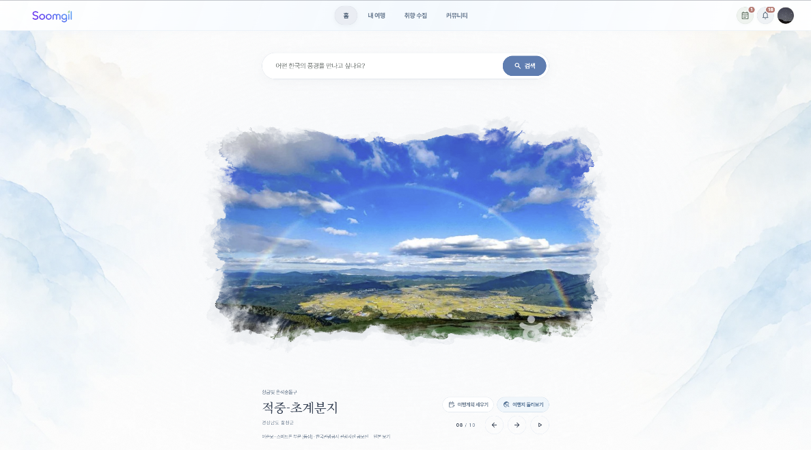<br />
      <strong>관광사진 수상작으로 여행지 발견</strong><br />
      <sub>사진과 촬영지를 둘러보고 마음에 드는 장소를 여행 계획에 추가합니다.</sub>
    </td>
    <td width="50%" align="center" valign="top">
      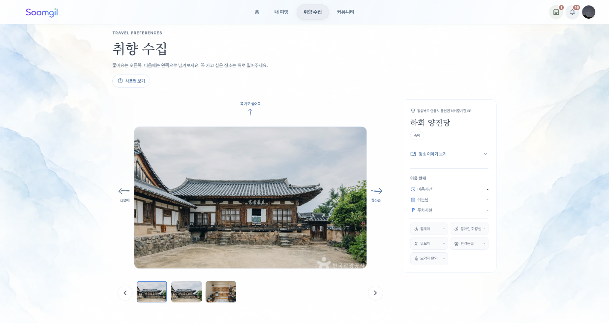<br />
      <strong>스와이프로 취향 수집</strong><br />
      <sub>좋아요·싫어요·가고 싶어요로 장소를 평가하고 개인화 추천에 반영합니다.</sub>
    </td>
  </tr>
  <tr>
    <td width="50%" align="center" valign="top">
      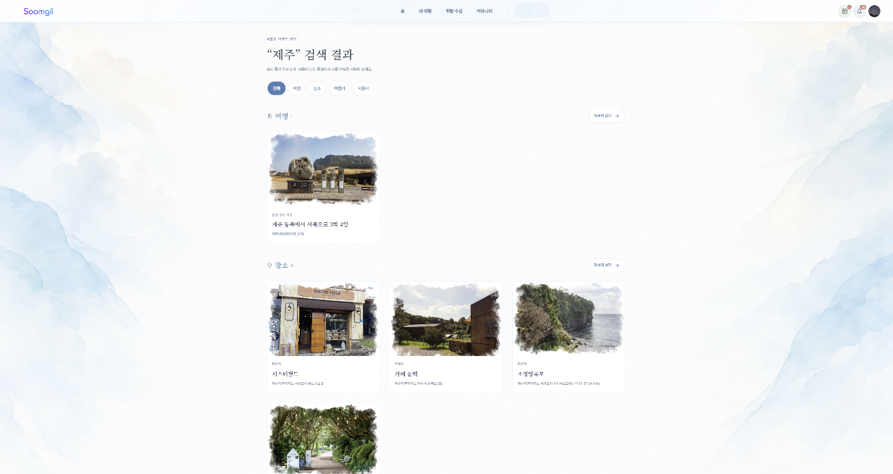<br />
      <strong>관광지·여행기 통합 검색</strong><br />
      <sub>관광지와 여행기를 함께 찾고 위치·운영시간·무장애 이용 정보를 확인합니다.</sub>
    </td>
    <td width="50%" align="center" valign="top">
      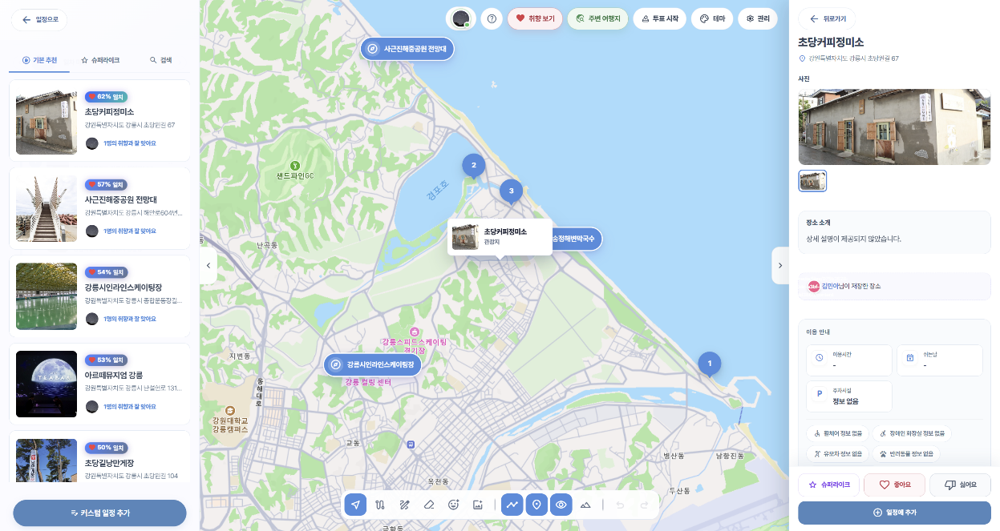<br />
      <strong>취향에 맞는 관광지 추천</strong><br />
      <sub>수집한 취향을 바탕으로 관광지를 추천받고 지도에서 상세 정보를 확인합니다.</sub>
    </td>
  </tr>
</table>

### 2. 함께 만드는 여행과 투표

<table>
  <tr>
    <td width="40%" align="center" valign="top">
      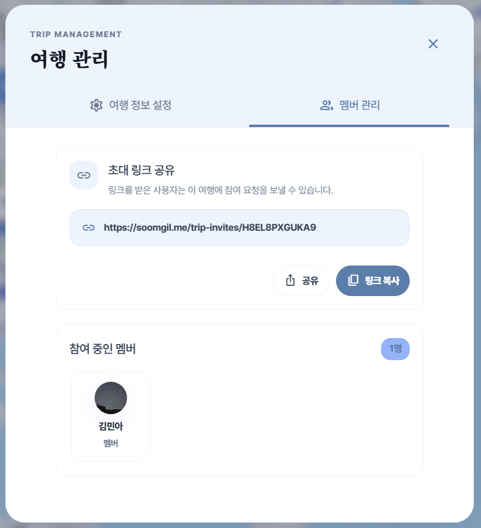<br />
      <strong>여행방 생성과 멤버 초대</strong><br />
      <sub>초대 URL을 공유해 같은 여행방에서 계획을 함께 작성합니다.</sub>
    </td>
    <td width="60%" align="center" valign="top">
      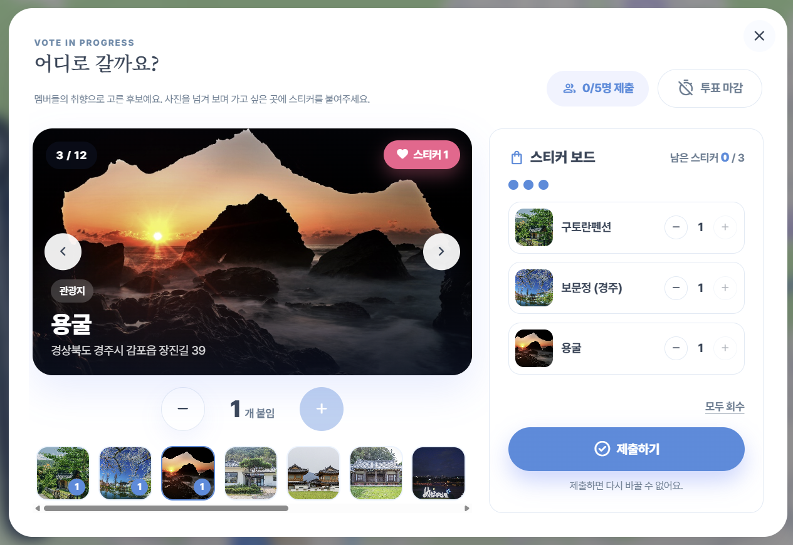<br />
      <strong>스티커로 방문지 투표</strong><br />
      <sub>가고 싶은 후보 관광지에 스티커를 붙여 초기 방문지를 정합니다.</sub>
    </td>
  </tr>
  <tr>
    <td colspan="2" align="center">
      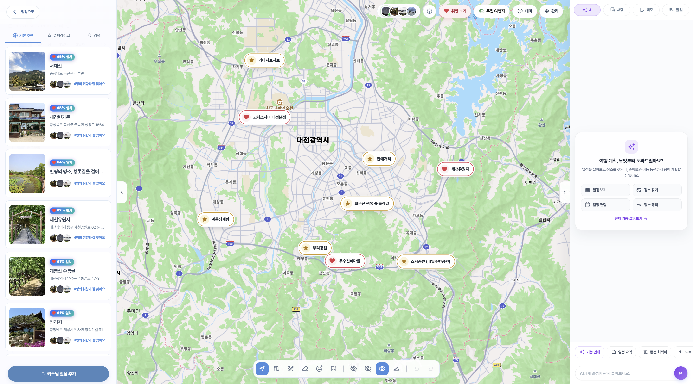<br />
      <strong>멤버 취향과 지도 범위를 반영한 추천</strong><br />
      <sub>멤버들이 함께 선택하기 좋은 장소를 제안하고, 지도를 이동하면 해당 영역의 후보를 찾습니다.</sub>
    </td>
  </tr>
</table>

### 3. 인터랙티브 여행 지도

<table>
  <tr>
    <td width="50%" align="center" valign="top">
      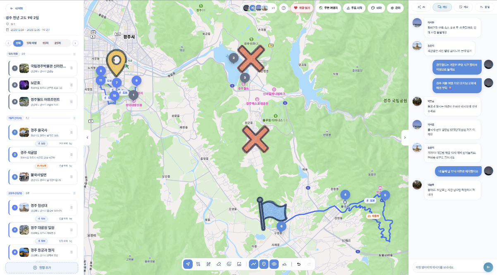<br />
      <strong>실시간 공동 지도 편집</strong><br />
      <sub>장소 추가와 순서 변경, 경로와 지도 오브젝트 편집을 멤버들과 공유합니다.</sub>
    </td>
    <td width="50%" align="center" valign="top">
      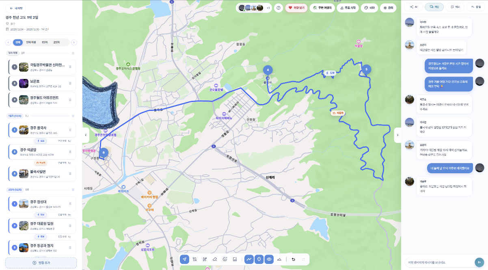<br />
      <strong>이동수단별 경로 생성</strong><br />
      <sub>지정한 동선을 도보·자전거·자동차에 맞는 도로 경로로 변환합니다.</sub>
    </td>
  </tr>
  <tr>
    <td width="50%" align="center" valign="top">
      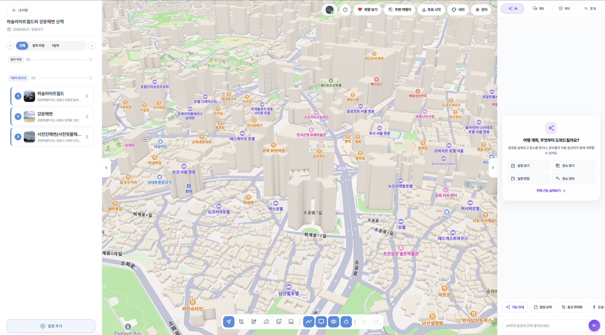<br />
      <strong>3D 지도</strong><br />
      <sub>입체 지도로 장소 주변의 지형과 건물을 확인합니다.</sub>
    </td>
    <td width="50%" align="center" valign="top">
      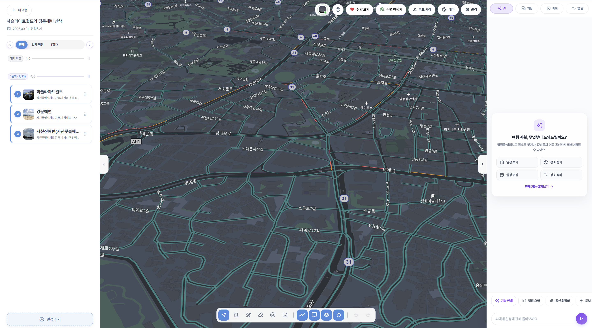<br />
      <strong>지도 테마와 꾸미기</strong><br />
      <sub>지도 테마를 바꾸고 그림·스티커·사진으로 계획과 추억을 표현합니다.</sub>
    </td>
  </tr>
</table>

### 4. AI 기반 여행 일정 설계

<table>
  <tr>
    <td colspan="2" align="center">
      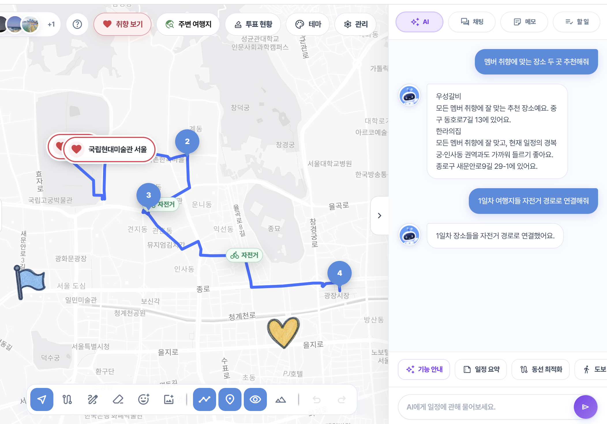<br />
      <strong>현재 계획을 참고하는 AI 여행 가이드</strong><br />
      <sub>여행방의 장소와 일정을 바탕으로 질문하고, 관광지 추천과 방문 순서·경로 조정을 요청합니다.</sub>
    </td>
  </tr>
  <tr>
    <td width="50%" align="center" valign="top">
      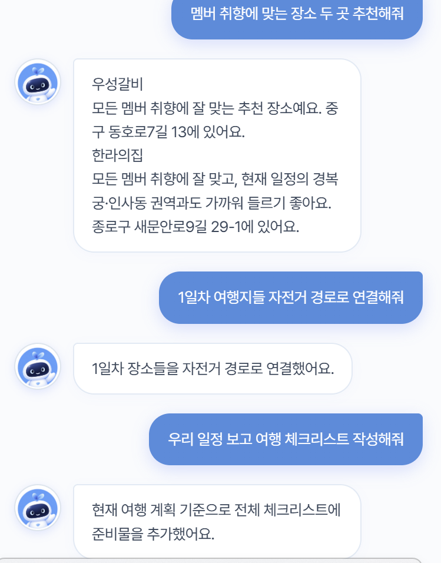<br />
      <strong>일정을 바탕으로 준비물 요청</strong><br />
      <sub>여행 계획을 참고해 필요한 준비 사항을 체크리스트로 만듭니다.</sub>
    </td>
    <td width="50%" align="center" valign="top">
      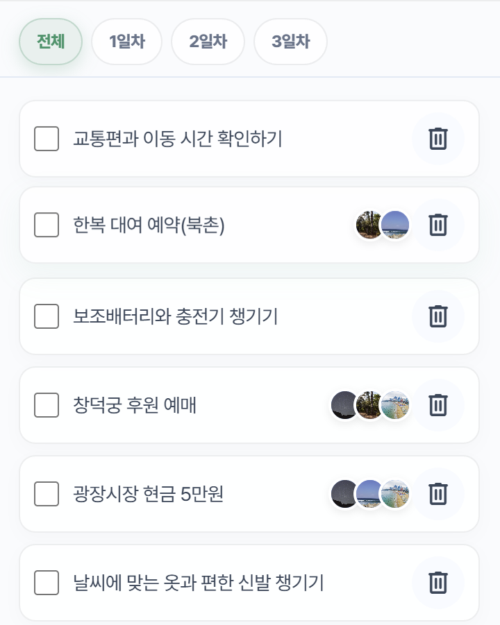<br />
      <strong>AI 체크리스트 확인과 편집</strong><br />
      <sub>생성된 항목을 추가·수정하고 멤버별 준비 상태를 확인합니다.</sub>
    </td>
  </tr>
</table>

### 5. 여행 협업과 커뮤니티

<table>
  <tr>
    <td width="50%" align="center" valign="top">
      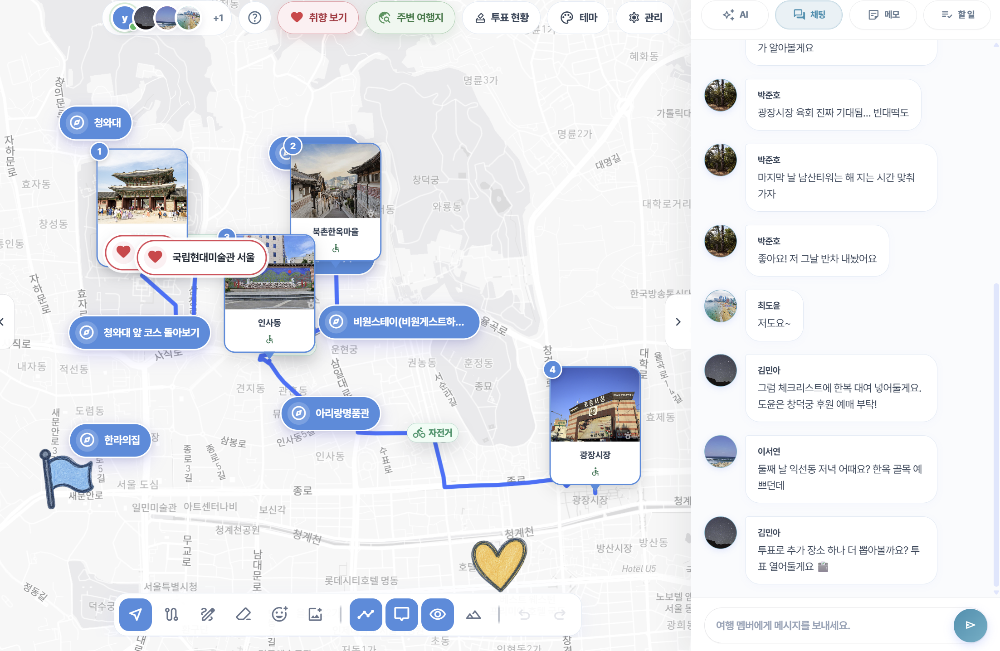<br />
      <strong>여행방 실시간 채팅</strong><br />
      <sub>일정과 장소를 함께 보며 멤버들과 여행 계획을 조율합니다.</sub>
    </td>
    <td width="50%" align="center" valign="top">
      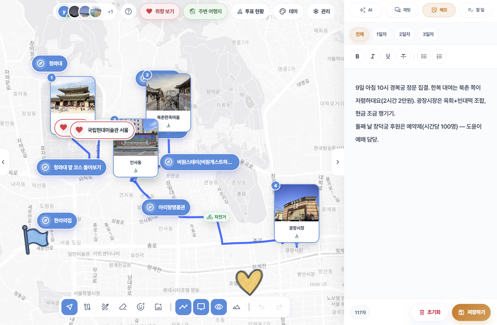<br />
      <strong>공동 메모</strong><br />
      <sub>여행 준비 중 기억해야 할 정보와 할 일을 여행방에서 공유합니다.</sub>
    </td>
  </tr>
  <tr>
    <td width="50%" align="center" valign="top">
      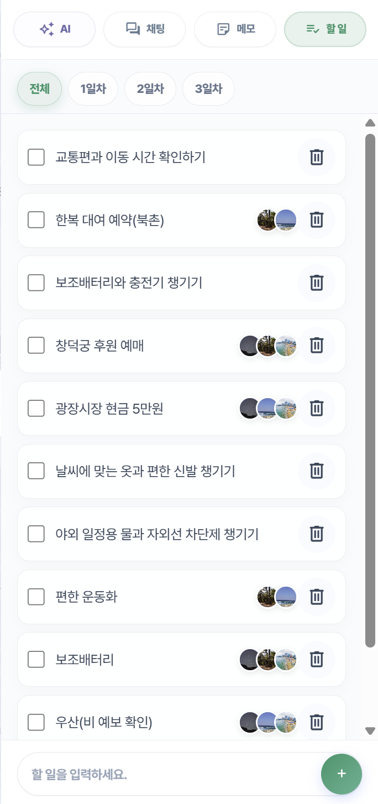<br />
      <strong>멤버별 체크리스트</strong><br />
      <sub>준비물과 예약 사항을 정리하고 멤버별 완료 여부를 확인합니다.</sub>
    </td>
    <td width="50%" align="center" valign="top">
      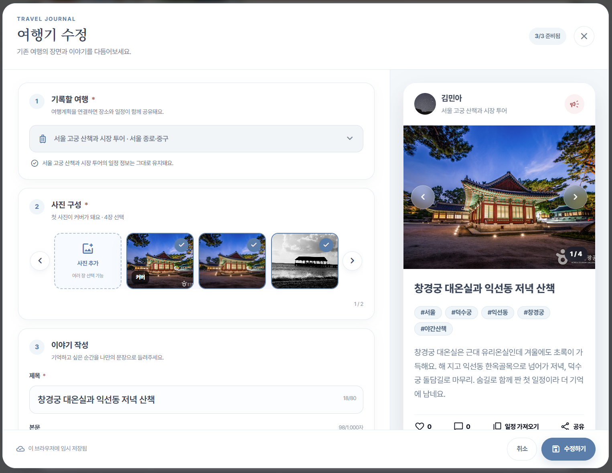<br />
      <strong>여행기 작성</strong><br />
      <sub>여행 계획과 사진, 실제 경험을 함께 담아 여행기를 작성합니다.</sub>
    </td>
  </tr>
  <tr>
    <td width="50%" align="center" valign="top">
      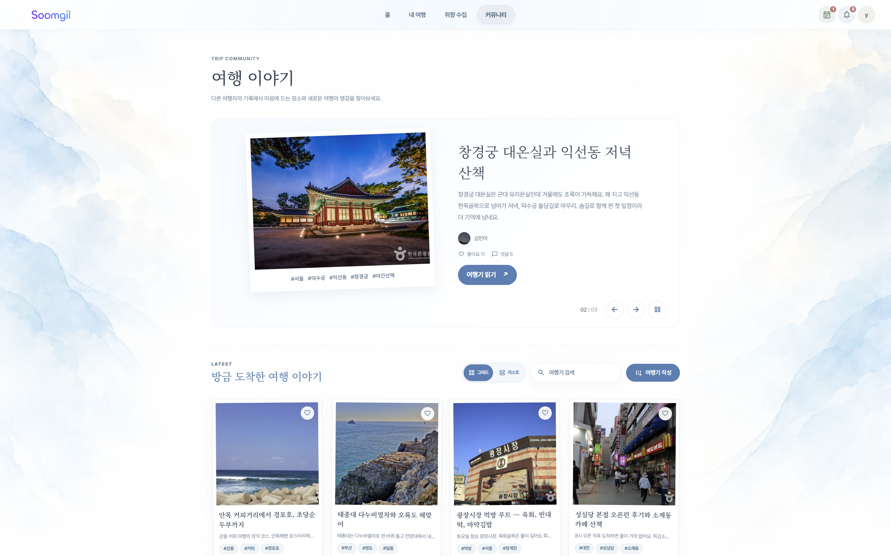<br />
      <strong>여행 경험 공유</strong><br />
      <sub>여행기를 공개하고 다른 여행자의 경험에서 새로운 국내 여행지를 찾습니다.</sub>
    </td>
    <td width="50%" align="center" valign="top">
      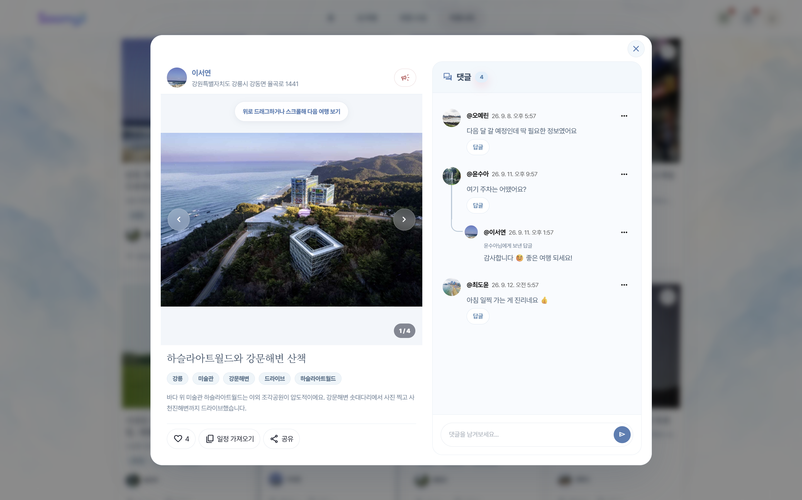<br />
      <strong>여행 가져오기 · 리트립</strong><br />
      <sub>공개된 장소·방문 순서·이동 경로를 가져와 내 여행에 맞게 수정합니다.</sub>
    </td>
  </tr>
</table>

기능 화면은 제공된 공모전 기능설명서의 이미지 원본을 사용했습니다. 화면별 슬라이드와 원본 이미지 경로는 [이미지 출처](docs/assets/README.md)에 정리했습니다.

---

<a id="technology-stack"></a>

## 🛠️ 기술 스택

| 분류 | 기술 |
| --- | --- |
| Frontend |     |
| Frontend 상태·지도·통신 |      |
| Backend |      |
| 인증·협업 |    |
| AI |   |
| Data |    |
| 로컬 인프라 |    |
| 검증 |      |

버전과 구성은 현재 프론트엔드·백엔드 서브모듈의 빌드 설정 및 루트 Docker Compose를 기준으로 정리했습니다.

---

<a id="system-architecture"></a>

## 🏗️ 시스템 아키텍처

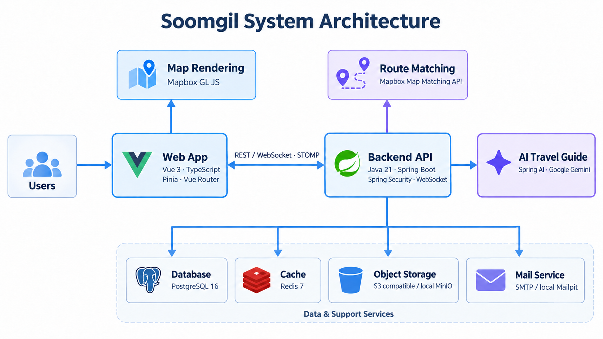

<details>
<summary>구성도 원본 (Mermaid)</summary>

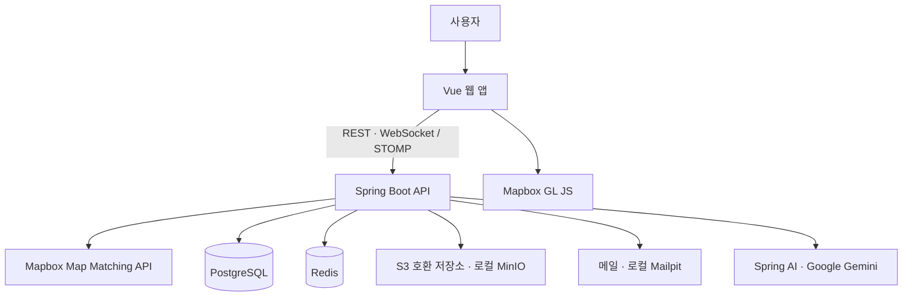

</details>

웹 앱은 REST API로 데이터를 조회·저장하고 WebSocket/STOMP로 여행방의 변경 사항을 공유합니다. 지도는 Mapbox GL JS로 표시하며, 서버는 경로 매칭과 AI 가이드, 인증 및 파일 저장을 처리합니다. 위 구성도는 애플리케이션 연결과 로컬 실행 환경을 요약합니다.

이 저장소는 독립된 제품 저장소를 서브모듈로 연결하는 orchestration repo입니다.

| 저장소 | 역할 |
| --- | --- |
| [soomgil](https://github.com/Soomgil/soomgil) | 통합 실행 설정, 루트 문서와 서브모듈 포인터 관리 |
| [soomgil-frontend](https://github.com/Soomgil/soomgil-frontend) | Vue 기반 웹 앱 |
| [soomgil-backend](https://github.com/Soomgil/soomgil-backend) | Spring Boot API 서버 |

---

<a id="erd"></a>

## 🗄️ ERD

전체 데이터 모델은 [DBML 스키마](.agent/contracts/schema.dbml)에서 확인할 수 있습니다. 아래는 사용자·여행방·일정·협업·여행기 사이의 주요 관계를 요약한 다이어그램입니다.

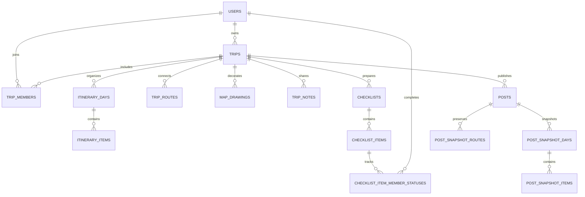

---

<a id="api-specification"></a>

## 📋 API 명세

| 문서 | 용도 |
| --- | --- |
| [OpenAPI 계약](.agent/contracts/openapi.yaml) | 인증, 여행방, 취향, 일정, 협업, AI, 커뮤니티 API의 V1 협의 초안 |
| [API 설계 문서](.agent/docs/api/api_spec.md) | 리소스별 동작과 상태, 접근 권한, 확인이 필요한 사항 |
| [백엔드 계약 결정](.agent/contracts/backend_contract_decisions.md) | 도메인 공통 정책과 프론트엔드·백엔드 계약 기준 |

로컬 API 서버를 실행하면 [Swagger UI](http://localhost:8080/swagger-ui/index.html)에서 구현된 명세를 확인할 수 있습니다. 저장소의 OpenAPI 계약에는 협의 중인 항목이 포함되어 있으므로 실제 응답은 실행 중인 서버의 명세와 함께 확인합니다.

---

<a id="technology-details"></a>

## 🔬 핵심 기술 상세

### 1. 취향 데이터와 그룹 관광지 추천

회원가입·홈·여행방 투표에서 수집한 장소 선호를 관광지 태그와 연결해 사용자별 취향을 축적합니다. 여행방에서는 참여 멤버의 선호와 현재 지도 범위를 함께 반영해 관광지 후보를 추천하고, 추천 장소를 일정에 바로 추가할 수 있습니다.

### 2. 실시간 공동 편집

일정, 경로와 지도 오브젝트의 변경은 서버에 저장한 뒤 WebSocket/STOMP로 여행방 멤버에게 전달합니다. 편집 요청은 기준 버전을 함께 보내 충돌을 확인하며, 커서와 접속 상태를 공유해 같은 지도에서 계획을 조율합니다.

### 3. 직접 그린 동선의 도로 경로 변환

사용자가 지정한 동선은 Mapbox Map Matching API를 통해 실제 도로 기반 경로로 변환합니다. 도보·자전거·자동차에 해당하는 프로파일을 적용해 이동 경로를 생성하고, 일정의 장소와 경로를 지도에 함께 표시합니다.

### 4. 여행방 맥락을 사용하는 AI 가이드

Spring AI와 Google Gemini를 연결한 가이드는 현재 여행방의 장소, 일정과 준비 정보를 참고합니다. 사용자가 요청한 작업에 따라 장소 검색·추천, 일정 편집, 메모 작성과 준비물 체크리스트 생성 도구를 호출합니다.

### 5. 여행 일정의 공유와 리트립

여행기를 발행할 때 장소, 방문 순서와 이동 경로를 스냅샷으로 보관합니다. 다른 사용자는 공개된 여행을 가져와 자신의 여행방에서 기간과 취향에 맞게 편집할 수 있습니다.

---

<a id="tourism-data"></a>

## 🗺️ 활용 관광데이터 및 외부 API

### 한국관광공사 OpenAPI

| 데이터 | 활용 |
| --- | --- |
| 국문 관광정보 서비스 | 지역·검색어별 관광지 목록과 주소·위치·소개·이용 정보·사진을 검색, 취향 분석과 추천에 활용합니다. |
| 무장애 여행 정보 | 휠체어 이용, 장애인 주차장, 접근 가능한 화장실 등의 편의 정보를 관광지 상세 화면에 제공합니다. |
| 관광공모전(사진) 수상작 정보 | 작품명·촬영지·촬영자·수상 내역과 사진으로 국내 관광지를 소개합니다. |

### 기타 API와 파일데이터

| 데이터·API | 활용 |
| --- | --- |
| Mapbox 지도 API · Mapbox GL JS | 관광지와 일정·이동 경로 표시, 3D 지도와 테마 전환 |
| Mapbox Map Matching API | 지정한 동선을 도보·자전거·자동차의 도로 경로로 변환 |
| Google Gemini API | 여행방 맥락을 참고하는 AI 가이드와 관광지 특징 분석 |
| 카카오 로그인 API · Google OAuth 2.0 | 소셜 계정을 이용한 회원가입과 로그인 |
| 정부 법정동 코드 파일데이터 | 시·도와 시·군·구 검색 및 관광지 검색 범위 설정 |

관광데이터 활용 내용은 제공된 기능설명서를 기준으로 정리했습니다. 사진은 촬영자·제공처 정보를 유지하며, 데이터 관리 기준은 [관광 데이터 출처 정책](.agent/docs/product-specs/tourism_source_policy.md), 화면과 사진의 출처는 [이미지 안내](docs/assets/README.md)를 참고합니다.

---

<a id="roadmap"></a>

## 🌱 발전 계획

| 방향 | 계획 |
| --- | --- |
| 그룹 추천 고도화 | 계절·여행 기간·동행 유형·예산·이동 가능 거리 등 여행 맥락을 추가로 반영합니다. |
| AI 일정 설계 고도화 | 운영시간·체류시간·이동시간을 함께 고려하는 자동 일정 생성과 동선 최적화를 개선합니다. |
| 상황에 맞는 일정 재설계 | 날씨·행사·교통·혼잡도·임시 휴무를 연동해 대체 장소와 경로를 제안합니다. |
| 모바일 경험 강화 | 모바일에서 추천·투표·일정 확인과 여행 중 위치 기반 안내를 강화합니다. |
| 관광 콘텐츠 확대 | 음식점·카페·숙박·축제·체험 프로그램으로 추천 범위를 넓힙니다. |
| 여행 지도 공유 확장 | 꾸민 지도의 이미지 저장과 링크·SNS 공유를 확장합니다. |

위 항목은 기능설명서에 제시한 향후 발전 계획입니다.

---

<a id="developer-guide"></a>

<details>
<summary><strong>🚀 개발자 가이드 (빌드·실행)</strong></summary>


## 빠른 실행 🚀

Docker Desktop이 필요합니다. 아래 Docker Compose 실행은 프론트엔드의 Node.js 환경도 컨테이너 안에서 준비합니다(`node:22-alpine`). 로컬에서 프론트엔드 개발·테스트나 실행 스크립트를 사용할 때는 **Node.js 22.12 이상인 22.x**를 권장합니다. 잠금 파일의 Vite 8·Vue 플러그인 요구 조건은 `^20.19.0 || >=22.12.0`이며, 하네스 자체 요구 조건은 Node.js 20 이상입니다.

```bash
git clone --recurse-submodules https://github.com/Soomgil/soomgil.git
cd soomgil
cp .env.example .env
docker compose --profile full up --build -d
```

이미 clone했다면 `git submodule update --init --recursive`로 제품 코드를 준비합니다. 환경변수는 [.env.example](.env.example)을 참고해 설정하세요. 지도에는 `MAPBOX_ACCESS_TOKEN`이 필요하며, AI·소셜 로그인 등 외부 연동도 해당 서비스 설정이 필요합니다.

접속 주소:

| 서비스 | 주소 |
| :--- | :--- |
| Frontend | http://localhost:5173 |
| Backend | http://localhost:8080 |
| Mailpit | http://localhost:8025 |
| MinIO Console | http://localhost:9001 |

로컬 `compose.yaml`은 `.env`에 AWS S3 값이 있더라도 파일 저장소를 MinIO로 고정합니다.
브라우저 직접 업로드 URL은 `http://localhost:9000`으로 서명되고, 백엔드는 Docker 내부 주소로 MinIO에 접근합니다.
AWS 배포 설정은 `compose.aws.yaml`과 `.env.aws`에서만 관리합니다.

### Gmail로 실제 인증 메일 보내기

Google 계정에서 2단계 인증과 앱 비밀번호를 설정한 뒤 루트 `.env`의 메일 항목을 다음처럼 지정합니다.

```properties
MAIL_HOST=smtp.gmail.com
MAIL_PORT=587
MAIL_USERNAME=your-account@gmail.com
MAIL_PASSWORD=your-google-app-password
MAIL_SMTP_AUTH=true
MAIL_SMTP_STARTTLS=true
MAIL_SMTP_STARTTLS_REQUIRED=true
MAIL_SMTP_SSL=false
MAIL_SMTP_SSL_TRUST=smtp.gmail.com
MAIL_SMTP_CHECK_SERVER_IDENTITY=true
```

`MAIL_PASSWORD`에는 Google 계정 비밀번호가 아닌 앱 비밀번호를 사용합니다. `MAIL_FROM`을 생략하면
`MAIL_USERNAME` 주소가 발신자로 사용됩니다. 실제 비밀번호가 든 `.env`는 커밋하지 않습니다.

중지:

```bash
docker compose --profile full down
```

## 자주 쓰는 명령

| 명령 | 설명 |
| :--- | :--- |
| `node start-soomgil.mjs both` | 프론트엔드와 백엔드 실행 |
| `node start-soomgil.mjs frontend` | 프론트엔드만 실행 |
| `node start-soomgil.mjs backend` | 백엔드와 필수 인프라 실행 |
| `node start-soomgil.mjs reset` | 로컬 데모 DB 초기화 |
| `node init-demo-dump.mjs` | 데모 데이터 v2 적재(DB 재생성 → Flyway → 덤프 → 검증). 계정·내용은 [backend/seeds/README.md](backend/seeds/README.md) |
| `node start-soomgil.mjs stop` | 전체 컨테이너 종료 |

Windows에서는 `start-soomgil.bat`, macOS에서는 `start-soomgil.command`를 사용할 수 있습니다.

## 📁 디렉터리 구조

```text
soomgil/
├─ frontend/                 # Vue 웹 앱 서브모듈
├─ backend/                  # Spring Boot API 서브모듈
├─ docs/assets/
│  └─ readme/                # 기능설명서에서 추출한 README 화면
│     ├─ overview/           # 대표 화면
│     └─ features/           # 관광지 탐색·그룹 여행·지도·AI·커뮤니티
├─ .agent/                   # AI 작업 문서·계약·하네스
│  ├─ contracts/             # DBML·OpenAPI 계약
│  ├─ docs/                  # 제품·아키텍처·개발 정책
│  └─ branch-ledger/         # 현재 브랜치의 작업 문맥
├─ compose.yaml             # 로컬 통합 실행 환경
├─ compose.aws.yaml         # AWS 배포 구성
├─ .env.example             # 환경변수 예시
├─ start-soomgil.mjs         # 통합 실행 스크립트
└─ README.md
```

## 🌿 브랜치 전략과 커밋 컨벤션

| 브랜치 | 용도 |
| --- | --- |
| `main` | 프로덕션 기준 |
| `develop` | 기능 통합 기준 |
| `feature/*` · `bugfix/*` | 기능 개발과 오류 수정 |
| `chore/*` | 문서·설정·하네스 정리 |
| `release/*` · `hotfix/*` | 배포 준비와 운영 긴급 수정 |

`main`과 `develop`에 직접 push하지 않고 PR로 통합합니다. 제품 코드는 해당 서브모듈에서 커밋하고, 루트 저장소에는 서브모듈 포인터와 통합 문서를 반영합니다.

커밋은 `<type>(<scope>): <summary>` 형식의 Conventional Commits를 사용합니다.

```text
feat(trip): add member invite flow
fix(preference): correct group recommendation score
docs(orchestration): update service introduction
chore(submodules): update frontend pointer
```

자세한 기준은 [Git 운영 정책](.agent/docs/process/git_workflow.md)을 참고합니다.

## 같은 구조로 새 프로젝트 시작

macOS와 Windows에서 공통으로 사용하는 Node.js 부트스트랩 도구가 있습니다.

```bash
npm --prefix .agent run project:bootstrap -- --dry-run
```

프로젝트별 설정과 사용법은 `.agent/bootstrap/project.example.json`과 `.agent/docs/harness/project_bootstrap_guide.md`를 참고합니다. 실행 환경이 없으면 `.agent/bootstrap/AI_PROJECT_BOOTSTRAP.md`를 AI 코딩 에이전트에게 전달합니다.

현재 프로젝트의 workspace 경계는 `.agent/workspaces.json`, 백엔드 공통 계약 결정은 `.agent/contracts/backend_contract_decisions.md`, 브랜치별 AI 문맥은 `.agent/branch-ledger/`가 관리합니다.

## 개발 메모

- 실제 제품 코드는 각 서브모듈 repo에서 커밋합니다.
- 이 루트 repo는 서브모듈 포인터와 통합 실행 설정을 관리합니다.
- Git Flow와 서브모듈 운영 규칙은 `.agent/docs/process/git_workflow.md`를 따릅니다.
- 실제 환경변수 파일인 `.env`는 커밋하지 않습니다.

## 관련 문서 📚

- [기능 명세](.agent/docs/product-specs/functional_spec.md) · [서비스 요구사항](.agent/docs/product-specs/service_requirements.md)
- [아키텍처 가이드](.agent/docs/architecture/architecture_guide.md) · [API 명세](.agent/docs/api/api_spec.md)
- [Git Flow·서브모듈 운영 규칙](.agent/docs/process/git_workflow.md)
- [프론트엔드 실행 안내](https://github.com/Soomgil/soomgil-frontend#readme) · [백엔드 실행 안내](https://github.com/Soomgil/soomgil-backend#readme)
- [관광 데이터 출처 정책](.agent/docs/product-specs/tourism_source_policy.md) · [화면·이미지 출처](docs/assets/README.md)
- [워크스페이스 구성](.agent/workspaces.json) · [백엔드 계약 결정](.agent/contracts/backend_contract_decisions.md) · [브랜치 작업 기록](.agent/branch-ledger/)
- 제품 코드 경계: `frontend/`는 웹 앱, `backend/`는 API 서버 서브모듈입니다.

</details>
